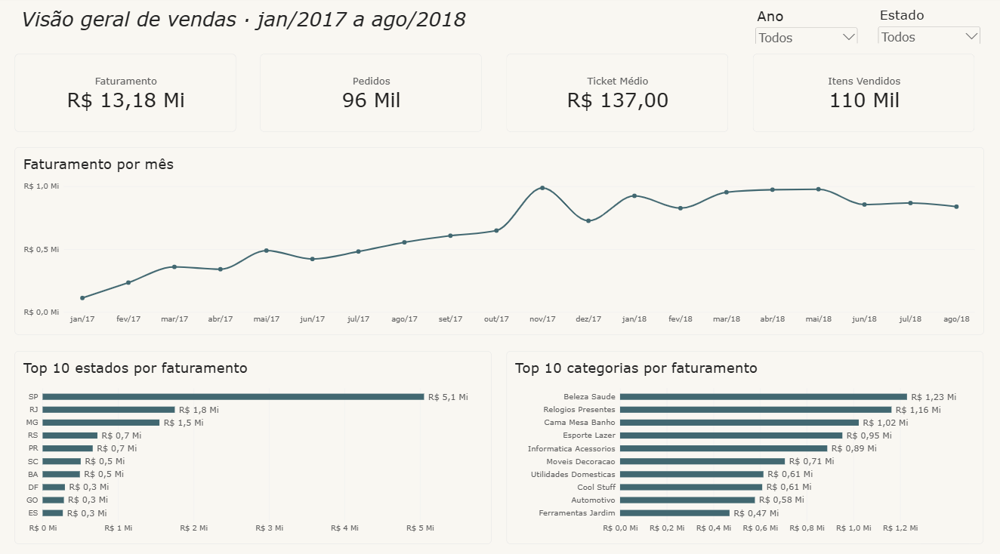
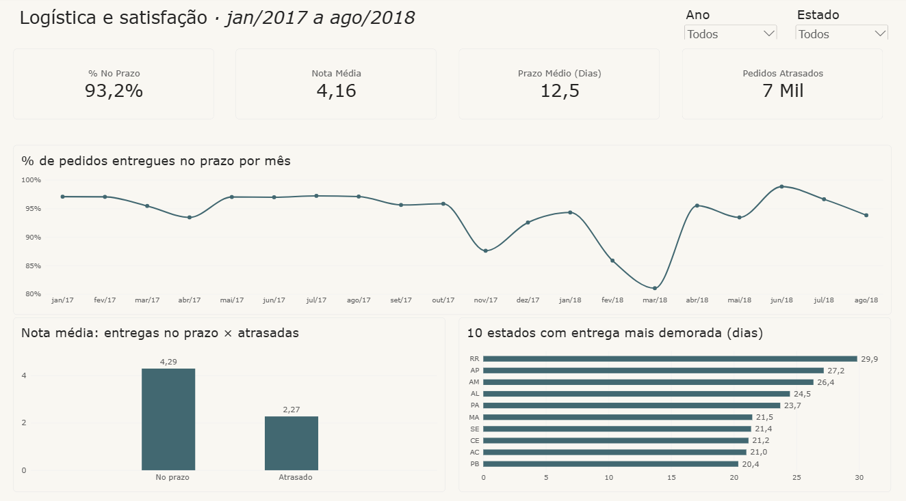

# Análise de E-commerce Olist · BigQuery + Power BI

Projeto de análise de dados de ponta a ponta com dados reais de um e-commerce brasileiro: da carga dos arquivos brutos no **BigQuery** até um **dashboard no Power BI**, passando por validação, tratamento em SQL e modelagem dimensional.



---

## 🎯 Objetivo

Entender o desempenho de vendas e a experiência de entrega do Olist entre **janeiro de 2017 e agosto de 2018**, respondendo perguntas de negócio e gerando recomendações a partir dos dados.

## ❓ Perguntas de negócio

1. Como o faturamento evoluiu mês a mês?
2. Quais estados e categorias vendem mais?
3. Quais formas de pagamento são mais usadas?
4. O atraso na entrega derruba a nota de avaliação do cliente?
5. Onde a logística é mais lenta?

## 🛠️ Ferramentas

| Ferramenta | Uso no projeto |
|---|---|
| **Google BigQuery** (Sandbox) | Armazém de dados: carga, validação, consultas SQL e views |
| **SQL** | Análises, tratamento e modelagem dos dados |
| **Power BI** | Modelo semântico, medidas DAX e dashboard |
| **GitHub** | Versionamento e documentação |

## 🔄 Etapas do projeto

```
CSVs (Kaggle) → Ingestão no BigQuery → Validação da carga → Análises em SQL
             → Tratamento e modelagem (views) → Power BI (modelo + DAX) → Dashboard
```

1. **Ingestão:** carga dos 9 arquivos CSV no BigQuery.
2. **Validação da carga:** conferência da quantidade de linhas de cada tabela (`sql/01_validacao_carga.sql`).
3. **Análises em SQL:** respostas às perguntas de negócio (`sql/02` a `sql/07`).
4. **Tratamento e modelagem dimensional:** criação de views em esquema estrela (`sql/08` a `sql/10`).
5. **Modelo semântico no Power BI:** relacionamentos, tabela calendário e medidas em DAX.
6. **Visualização:** dashboard com duas páginas (vendas; logística e satisfação).

## 🗂️ Dados

**Fonte:** [Brazilian E-Commerce Public Dataset by Olist (Kaggle)](https://www.kaggle.com/datasets/olistbr/brazilian-ecommerce): cerca de 100 mil pedidos reais, feitos entre 2016 e 2018 em marketplaces brasileiros.

| Tabela | Linhas | Conteúdo |
|---|---|---|
| pedidos | 99.441 | Status e datas de cada pedido |
| itens_pedido | 112.650 | Produtos, preço e frete de cada pedido |
| clientes | 99.441 | Cidade e estado do cliente |
| produtos | 32.951 | Categoria e características dos produtos |
| vendedores | 3.095 | Localização dos vendedores |
| pagamentos | 103.886 | Forma de pagamento e valor |
| avaliacoes | 99.224 | Nota e comentários dos clientes |
| geolocalizacao | 1.000.163 | CEP com latitude e longitude |
| traducao_categorias | 71 | Tradução das categorias para inglês |

## 📏 Regras de negócio

- **Período analisado:** janeiro de 2017 a agosto de 2018. Em 2016 os dados são incompletos (outubro com poucos pedidos, novembro sem nenhum e dezembro com apenas 1), e os pedidos posteriores a agosto de 2018 não constam como entregues.
- **Apenas pedidos entregues** (`order_status = 'delivered'`), excluindo os marcados como entregues mas sem data de entrega.
- **Faturamento** = soma do preço dos itens, sem o frete. Por categoria, usa o preço do item, já que o pagamento é do pedido inteiro.
- **Entrega no prazo:** data de entrega ao cliente menor ou igual à data estimada.
- **Nota média e prazo médio** calculados contando **cada pedido uma vez**, mesmo quando ele tem vários itens.

## 🧹 Tratamento de dados

- Padronização dos nomes das cidades (`INITCAP`).
- Categorias com nome legível e tratamento de valores vazios (`REPLACE`, `INITCAP`, `COALESCE`).
- Remoção de duplicidade de avaliações por pedido com uma CTE, evitando que o JOIN duplique linhas.
- Colunas calculadas: dias de entrega, dias de atraso e situação da entrega.

## ⭐ Modelo de dados (esquema estrela)

```
                vw_dim_clientes
               (cidade, estado)
                      │
   Calendario ── vw_fato_vendas ── vw_dim_produtos
   (datas)     (1 linha por item       (categoria)
                vendido)
```

- **Fato:** `vw_fato_vendas`, com preço, frete, datas, situação da entrega e nota.
- **Dimensões:** `vw_dim_clientes`, `vw_dim_produtos` e a tabela `Calendario`, criada em DAX.

## 🧮 Medidas DAX

| Medida | Descrição |
|---|---|
| Faturamento | Soma do preço dos itens |
| Pedidos | Quantidade de pedidos distintos |
| Ticket Médio | Faturamento ÷ pedidos |
| Itens Vendidos | Quantidade de itens |
| Nota Média | Média das notas, contando cada pedido uma vez (`AVERAGEX`) |
| % No Prazo | Pedidos entregues no prazo ÷ total de pedidos (`CALCULATE`) |
| Prazo Médio de Entrega | Média de dias entre compra e entrega, por pedido |
| Pedidos Atrasados | Quantidade de pedidos entregues após o prazo |

## 📊 Dashboard

**Página 1 · Visão geral de vendas**


**Página 2 · Logística e satisfação**


## 💡 Principais conclusões

**Números gerais do período:** R$ 13,18 milhões de faturamento, 96 mil pedidos, ticket médio de R$ 137 e 93,2% dos pedidos entregues no prazo.

1. **O atraso derruba a nota.** Pedidos entregues no prazo têm nota média de **4,29**; os atrasados, de **2,27**. Uma queda de 2 pontos, quase metade da nota.
2. **O faturamento cresceu ao longo de 2017**, com pico em **novembro de 2017 (Black Friday)**, e se estabilizou em patamar alto em 2018.
3. **O faturamento é concentrado no Sudeste.** São Paulo responde por cerca de **R$ 5,1 milhões**, perto de 39% do total, seguido por RJ e MG.
4. **Beleza e Saúde, Relógios e Presentes, e Cama, Mesa e Banho** lideram o faturamento. Cama, Mesa e Banho é a categoria com mais itens vendidos, mas fica em 3º no faturamento, indicando itens de menor valor.
5. **A pontualidade cai em momentos de pico.** Em novembro de 2017, os pedidos no prazo caíram para cerca de 88%.
6. **Ponto de atenção:** em fevereiro e março de 2018, a pontualidade caiu para cerca de 81% **sem coincidir com pico de vendas**. Os dados disponíveis não explicam a causa, e a queda merece investigação.
7. **Norte e Nordeste esperam muito mais.** Os 10 estados com entrega mais demorada são dessas regiões. Roraima chega a quase **30 dias**, mais que o dobro da média nacional de 12,5 dias.

## ✅ Recomendações

- Reforçar a capacidade logística **antes dos picos de vendas**, como a Black Friday.
- Priorizar melhorias de entrega para o **Norte e o Nordeste**.
- Acompanhar mensalmente o **% de pedidos entregues no prazo** como indicador principal, já que ele impacta diretamente a satisfação.

## 🔭 Próximos passos

- Analisar a localização dos vendedores para testar a hipótese de que a distância explica os prazos maiores no Norte e no Nordeste.
- Investigar a queda de pontualidade de fevereiro e março de 2018.
- Refazer as transformações em **dbt**, com testes de qualidade automatizados.

## 📁 Estrutura do repositório

```
projeto-ecommerce-olist/
├── README.md
├── sql/
│   ├── 01_validacao_carga.sql
│   ├── 02_pedidos_por_estado.sql
│   ├── 03_faturamento_por_estado.sql
│   ├── 04_faturamento_mensal.sql
│   ├── 05_categorias_mais_vendidas.sql
│   ├── 06_formas_pagamento.sql
│   ├── 07_entrega_x_avaliacao.sql
│   ├── 08_vw_dim_clientes.sql
│   ├── 09_vw_dim_produtos.sql
│   └── 10_vw_fato_vendas.sql
├── powerbi/
│   └── olist_dashboard.pbix
└── imagens/
    ├── visao_geral.png
    └── logistica_satisfacao.png
```

## ▶️ Como reproduzir

1. Baixe os arquivos CSV no [Kaggle](https://www.kaggle.com/datasets/olistbr/brazilian-ecommerce).
2. No BigQuery, crie o conjunto de dados `olist` (região US) e carregue cada CSV como uma tabela. A tabela de avaliações exige a opção "Permitir novas linhas entre aspas".
3. Rode `sql/01_validacao_carga.sql` e confira a quantidade de linhas.
4. Rode os arquivos `sql/08` a `sql/10` para criar as views.
5. Abra `powerbi/olist_dashboard.pbix`, informe o seu projeto do BigQuery e atualize os dados.

---

**Autor:** Flávio de Assis Batista Júnior · [LinkedIn](http://linkedin.com/in/flavio-de-assis)
